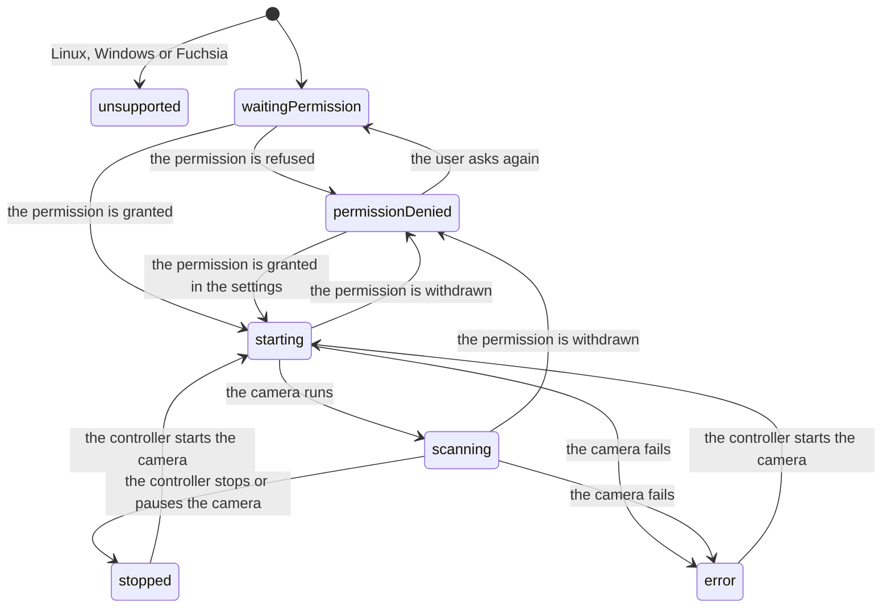

<!--
SPDX-FileCopyrightText: 2023 Benoit Rolandeau <benoit.rolandeau@allcircuits.com>

SPDX-License-Identifier: LicenseRef-ALLCircuits-ACT-1.1
-->

# ACT Barcode <!-- omit from toc -->

## Table of contents

- [Table of contents](#table-of-contents)
- [Presentation](#presentation)
- [Architecture](#architecture)
  - [Displaying a code](#displaying-a-code)
  - [Reading a code](#reading-a-code)
  - [The status of the scanner](#the-status-of-the-scanner)
  - [The camera permission](#the-camera-permission)
- [How to use](#how-to-use)
  - [Installation](#installation)
  - [Display a code](#display-a-code)
  - [Read a code](#read-a-code)
  - [Register what the scanner needs](#register-what-the-scanner-needs)
  - [Platform prerequisites](#platform-prerequisites)
- [Testing](#testing)

## Presentation

This package holds the two widgets of an application which works with barcodes: `QrCodeImage`,
which displays a QR code, and `BarcodeScannerWidget`, which reads the barcodes seen by the camera, QR
codes included.

The two are independent. Displaying a code needs nothing from the device; reading one needs the
camera and the permission which goes with it.

| Platform                    | `QrCodeImage` | `BarcodeScannerWidget`                |
| --------------------------- | ------------- | ------------------------------------- |
| Android, iOS, macOS and web | yes           | yes                                   |
| Linux and Windows           | yes           | no, it displays `unsupportedPlatform` |

## Architecture

### Displaying a code

`QrCodeImage` draws the code as a vector picture. It builds the picture once and keeps it, because
encoding a text as a code costs enough for it to be worth not doing it at every build. The picture
is built again when the text, the colour or the correction level changes, and kept when only the
size does: the same picture is drawn larger or smaller.

The correction level is how much of a code can be damaged or hidden and still be read. A higher
level survives more damage but makes the code denser, so the default is the lowest one, which suits
a code displayed on a screen.

| Level      | Recoverable |
| ---------- | ----------- |
| `low`      | 7%          |
| `medium`   | 15%         |
| `quartile` | 25%         |
| `high`     | 30%         |

The encoding itself comes from [barcode](https://pub.dev/packages/barcode), and the picture is
drawn by [flutter_svg](https://pub.dev/packages/flutter_svg).

### Reading a code

`BarcodeScannerWidget` shows what the camera sees and hands over every barcode it reads. It is built
on [mobile_scanner](https://pub.dev/packages/mobile_scanner), which reads all the usual formats, and
the reading is continuous: the application stops, pauses or starts the camera again through a
`MobileScannerController`. The widget wraps a bloc, `BarcodeScannerBloc`, which is not exported: it
holds the status of the scanner, follows the camera permission and the controller, and owns the
controller lifecycle. The parameters, the size rules and the controller ownership are documented on
the widget.

### The status of the scanner

The bloc holds the status of the scanner and what the widget shows follows it. The status is empty
until the bloc has emitted the first one, and the widget then shows the `waitingPermission` text.



| Status              | What the widget shows                                          |
| ------------------- | -------------------------------------------------------------- |
| `unsupported`       | the text `unsupportedPlatform`                                 |
| `waitingPermission` | the text `waitingPermission`                                   |
| `permissionDenied`  | the text `permissionDenied` and a button `askPermissionButton` |
| `starting`          | the camera view, its frame and the overlay                     |
| `scanning`          | the camera view, its frame and the overlay                     |
| `stopped`           | the camera view, its frame and the overlay                     |
| `error`             | the text `cameraError` in place of the camera view             |

Every text goes through the `textGetter` of the application, which translates a
`BarcodeScannerText`. `onStatusChanged` is called at each change of the status, the first status
included, so an application can react without reading the widget.

Once the permission is granted, the bloc deduces `starting`, `scanning`, `stopped` and `error` from
the `MobileScannerState` of the controller. `stopped` only follows a camera which has run: a camera
which has not started yet is `starting`.

### The camera permission

The permission is not asked by `mobile_scanner` but through `act_permissions_manager`, with
`PermissionElement.camera`. That is what shows the pages the application registered to explain why
the camera is needed, and what tells a refusal from a permanent refusal: for the latter, the page
of the application is displayed, or the settings are opened.

The bloc asks as soon as the widget is displayed. It also follows the permission: one granted in the
settings makes a denied scanner start, and one withdrawn makes a running scanner denied. The button
shown when the permission is denied asks again.

`PermissionElement.camera` stands for no permission on macOS and on the web, so it is granted there,
and it is `mobile_scanner` which lets the system ask for the camera. A refusal then comes as an
`error`, not as `permissionDenied`.

## How to use

### Installation

Add the package to the `dependencies` of your package:

```yaml
dependencies:
  act_barcode:
    path: ../act_barcode
```

### Display a code

```dart
QrCodeImage(
  text: serialNumber,
  color: Theme.of(context).colorScheme.onSurface,
  size: 200,
  errorCorrectLevel: BarcodeQRCorrectionLevel.medium,
)
```

Nothing has to be registered, and the widget reaches nothing outside of itself.

### Read a code

```dart
BarcodeScannerWidget(
  textGetter: (context, text) => switch (text) {
    BarcodeScannerText.unsupportedPlatform => Tr.of(context).scannerUnsupported,
    BarcodeScannerText.waitingPermission => Tr.of(context).cameraWaiting,
    BarcodeScannerText.permissionDenied => Tr.of(context).cameraRefused,
    BarcodeScannerText.askPermissionButton => Tr.of(context).askAgain,
    BarcodeScannerText.cameraError => Tr.of(context).cameraFailed,
  },
  onCodeFound: (barcode) => setState(() => _lastCode = barcode.rawValue),
)
```

The parameters, the size rules, the controller ownership and what each status shows are documented
in the dartdoc of `BarcodeScannerWidget`.

### Register what the scanner needs

The scanner reads three managers from the global manager of the application:

```dart
class AppGlobalManager extends AbsGlobalManager {
  @override
  Future<void> registerManagers() async {
    registerManagerAsync(const PlatformBuilder());
    registerManagerAsync(AppLifeCycleBuilder());
    registerManagerAsync(PermissionsBuilder());
  }
}
```

An application which registers the pages of `act_permissions_manager` registers the ones of
`PermissionElement.camera` too, see the README of that package. One which has none passes
`displayContextualIfNeeded: false`: the permission is then asked of the device directly, and a
permanent refusal opens the settings.

### Platform prerequisites

The setup each platform needs is described by the packages which require it:

- the README of [mobile_scanner](https://pub.dev/packages/mobile_scanner): the setup of each
  platform, and the choice between the ML Kit bundled in the application and the unbundled one;
- the setup section of [permission_handler](https://pub.dev/packages/permission_handler): the
  `Podfile` macro which enables the camera permission on iOS.

## Testing

The tests of the widget which displays a code pump it and read the picture it drew: the size it is
drawn at, the pictures which differ because the text, the colour or the correction level differ,
the picture which is built again when one of those changes, and the one which is kept when only the
size changes.

The scanner is tested without any real camera. `FakeMobileScannerPlatform` replaces the platform of
`mobile_scanner`: it starts without a camera, draws an empty view and sends the captures the test
gives it. `FakePermissionsPlatform`, `FakePlatformManager` and `FakeAppLifeCycleManager` answer the
permissions, the platform and the life cycle of the application; they are copies of the fakes of
`act_permissions_manager`, whose `test` folder another package can't import, each in its own file.
The tests pass `displayContextualIfNeeded: false`: the display of the pages is covered by the tests
of that package.

The bloc is tested on the platforms which are unsupported and ask nothing of the device, the
permission which is already granted, the one which is asked for and then given, the one which is
refused, the one which is asked for again after a refusal, the one which is granted or withdrawn in
the settings, the values of the controller which give `scanning`, `stopped` and `error`, and the
controller which is disposed only when the bloc created it. The state is tested on its copy methods
(the status after the permission and after each value of the controller, and the `forceStatusValue`
flag of `copyWith`), and the events on their equality.

The widget is tested on the text of each status, the button which asks the permission again, the
codes which reach `onCodeFound` according to the validator, the status given to `onStatusChanged`,
the overlay drawn over the camera, the sizes, the status which survives a new build, and the
controller which is disposed only when the widget's bloc created it.

```console
> flutter analyze --fatal-infos .
> flutter test
```
