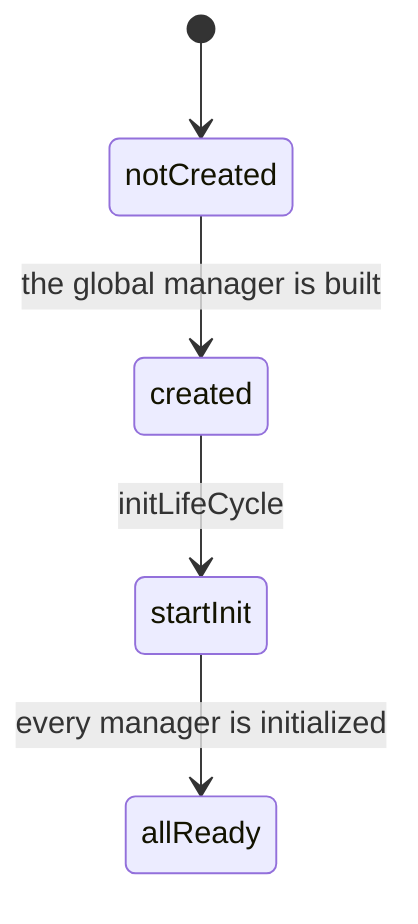

<!--
SPDX-FileCopyrightText: 2020 - 2023 Sami Kouatli <sami.kouatli@allcircuits.com>
SPDX-FileCopyrightText: 2023 - 2026 Benoit Rolandeau <benoit.rolandeau@allcircuits.com>

SPDX-License-Identifier: LicenseRef-ALLCircuits-ACT-1.1
-->

# ACT Dart global manager <!-- omit from toc -->

## Table of contents

- [Table of contents](#table-of-contents)
- [Presentation](#presentation)
- [Architecture](#architecture)
  - [The states of an application](#the-states-of-an-application)
  - [The order the managers are initialized in](#the-order-the-managers-are-initialized-in)
  - [The shortcuts](#the-shortcuts)
  - [The config manager of the usual host](#the-config-manager-of-the-usual-host)
- [How to use](#how-to-use)
  - [Installation](#installation)
  - [Write the global manager of the host](#write-the-global-manager-of-the-host)
  - [Start the global manager](#start-the-global-manager)
  - [Read the config from the file system](#read-the-config-from-the-file-system)
  - [Reach a manager](#reach-a-manager)
- [Testing](#testing)

## Presentation

This package holds the global manager of an application: the one object which knows every manager,
initializes them in the right order, and hands them out to whoever needs one. It is pure Dart: it
does not depend on Flutter, so a server, a script or a test running on the Dart VM can use it.

A host derives it, registers its managers, and stops thinking about their order: a manager declares
what it depends on, and the global manager initializes it once those are ready.

The package holds no business logic and knows nothing about the managers it initializes. What needs
Flutter is not here: the view, the fatal error page, `runActApp` and the information of the
application package (`packageInfo`) belong to `act_global_manager`, which depends on this package
and exports it.

## Architecture

### The states of an application

A host goes forward through the states of `GlobalManagerState`, and never back:



A step which has already been reached is refused rather than run again, which is what makes a second
initialization harmless. A derived class can add states after those (this is how
`act_global_manager` adds the one of the first view) by overriding `getGlobalManagerStates`.

### The order the managers are initialized in

A manager is registered with its builder, which lists the managers it depends on. The global manager
first records every registration; once `registerManagers` returns, it sorts the managers level by
level from these dependencies, registers them in `GetIt` as asynchronous singletons in that order,
and waits for all of them to be ready. `GetIt` initializes a manager only once the ones it depends
on are.

A dependency which is never registered, or managers which depend on each other, cannot be sorted:
the global manager raises an `ActManagerRegisteringDeadLoopError`.

The managers are kept in the order they finished their initialization, and they are disposed
together when the global manager is.

### The shortcuts

`globalGetIt()` gives the `GetIt` instance of the application and `appLogger()` its logger. Both go
through the global manager instance, which the derived class sets when it is built, so that a class
which needs a manager does not have to be given one.

The logger exists before any manager: it is the safe logger of `act_logger_manager`, which writes to
the console until the logger manager replaces it.

`isReleaseMode` tells whether the host has been built in release mode. It reads the same
compilation variable as the `kReleaseMode` constant of Flutter, so both give the same value in a
Flutter application.

### The config manager of the usual host

`AbsUsualFileConfigManager` is a config manager which reads its files from the file system and
already carries the variables the logger manager reads, and `ExtDefaultLoggerBuilder` builds the
default logger manager from the config manager registered in the host. Together they are the
shortest way to a working pair of config and logger managers; a host which needs more derives
`AbsFileConfigManager` itself.

`AbsUsualFileConfigManager` is the pure Dart counterpart of `AbsUsualConfigManager`, which loads the
config from the assets of a Flutter application.

It relies on `dart:io`, which is not available on the web, so it is not exported by the main library
of the package: import `package:act_dart_global_manager/usual_file_config_manager.dart` to use it.

## How to use

### Installation

Add the package to the `dependencies` of your package:

```yaml
dependencies:
  act_dart_global_manager:
    path: ../../dart/act_dart_global_manager
```

A Flutter package depends on `act_global_manager` instead, which exports this package.

### Write the global manager of the host

```dart
class AppGlobalManager extends AbsGlobalManager {
  static AppGlobalManager get instance {
    if (AbsGlobalManager.instance == null) {
      AbsGlobalManager.setInstance = AppGlobalManager._create();
    }

    return AbsGlobalManager.instance! as AppGlobalManager;
  }

  AppGlobalManager._create() : super.create();

  @override
  Future<void> registerManagers() async {
    registerManagerAsync(AppConfigBuilder());
    registerManagerAsync(ExtDefaultLoggerBuilder<AppConfigManager>());
    registerManagerAsync(MyManagerBuilder());
  }
}
```

Each builder declares the managers it depends on, and the global manager initializes them in that
order.

The `instance` getter creates the global manager the first time it is read and sets it as the
instance of `AbsGlobalManager`, which the shortcuts go through. The host reaches its global manager
through this getter only: the global manager is not registered in `GetIt`.

### Start the global manager

A pure Dart host starts its managers by calling `initLifeCycle`, and releases them with
`disposeLifeCycle`:

```dart
Future<void> main() async {
  final globalManager = AppGlobalManager.instance;
  await globalManager.initLifeCycle();

  // ... the host runs

  await globalManager.disposeLifeCycle();
}
```

### Read the config from the file system

Derive `AbsUsualFileConfigManager` and add the variables the host needs. The config is read from the
`config` directory of the working directory, or from the one named by `ACT_CONFIG_DIR`, for the
environment given by the `ENV` variable of the process:

```dart
import 'package:act_dart_global_manager/usual_file_config_manager.dart';

class AppConfigManager extends AbsUsualFileConfigManager {
  final serverPort = const NotNullableConfigVar<int>("server.port", defaultValue: 8080);

  AppConfigManager({required super.logger});
}

class AppConfigBuilder extends AbsCoreConfigBuilder<AppConfigManager> {
  AppConfigBuilder() : super(() => AppConfigManager(logger: appLogger()));
}
```

### Reach a manager

```dart
final myManager = globalGetIt().get<MyManager>();
```

## Testing

The tests drive a global manager which registers the managers a test asks for, and fake managers
which record the steps of their life cycle they have been through.

They cover the initialization of the registered managers and the order it follows, the registration
which is refused when a dependency is missing, the second initialization which does nothing, the
states which are refused because they have been reached or because they are not the ones of the
application, and the disposal of the managers. They also cover the builder of the default logger
manager and the usual file config manager, which reads the level of the logs from a temporary
directory.

The instance of the global manager and the `GetIt` it registers into are shared by the whole
process: each test builds its own manager, which becomes the instance.

```console
> dart test
```
